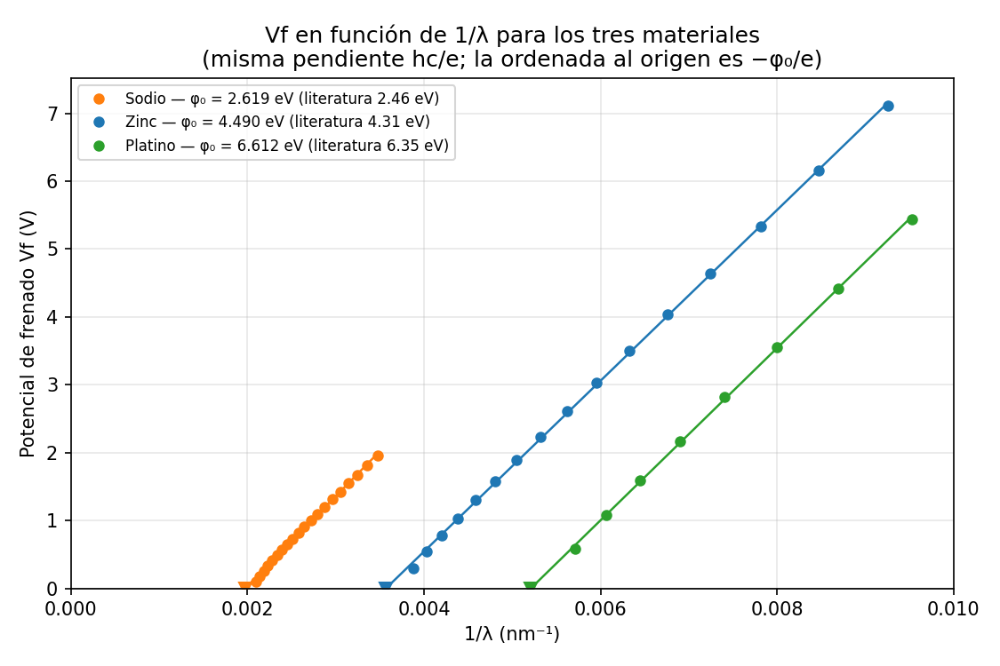
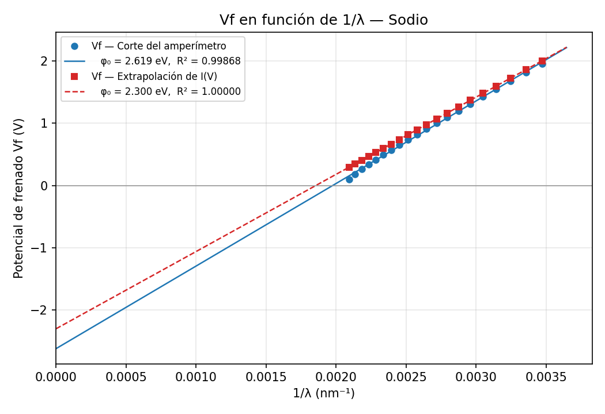
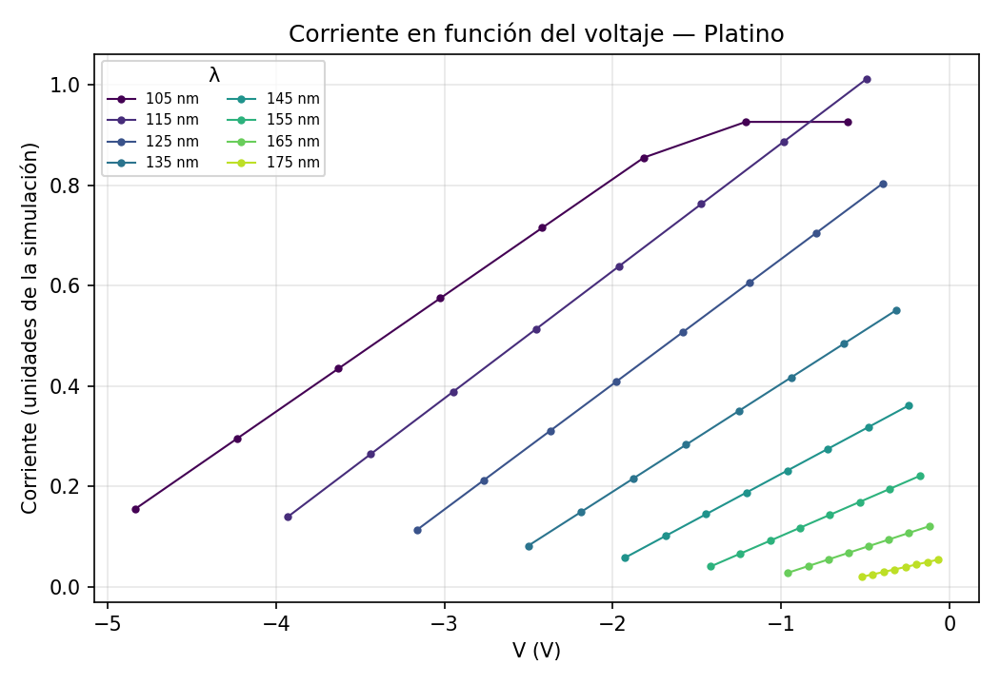

# Efecto fotoeléctrico: medición automatizada sobre una simulación de PhET

Mide de forma automática la longitud de onda crítica λC y el potencial de frenado Vf de
sodio, zinc y platino en la simulación
[Efecto Fotoeléctrico](https://phet.colorado.edu/es/simulation/legacy/photoelectric) de
PhET, grafica Vf en función de 1/λ, hace la regresión y de ahí saca la función trabajo φ₀
de cada material y la constante de Planck.

Nació de una práctica de laboratorio de Física 2 (Lic. en Biotecnología), donde para cada
uno de los tres materiales hay que buscar a tientas la longitud de onda crítica y después,
en veinte longitudes de onda distintas, ir subiendo el voltaje de la batería hasta que el
amperímetro deje de marcar. Son más de mil combinaciones de perillas que se pueden probar
sin cambiar nada del método.

## Resultados

La regresión de Vf contra 1/λ tiene pendiente hc/e y ordenada al origen −φ₀/e, así que de
una sola recta salen φ₀ y h. Con los dos criterios para decidir cuándo se frenó el último
electrón (ver [Método](#método)):

| Material | Método | n | Pendiente (V·nm) | R² | φ₀ exp (eV) | φ₀ literatura (eV) | Δφ₀ | h exp (J·s) | Δh |
|---|---|---|---|---|---|---|---|---|---|
| Na | Corte del amperímetro | 20 | 1326 ± 11 | 0.9987 | 2.619 ± 0.031 | 2.46 | +6.5 % | 7.086 × 10⁻³⁴ | +6.9 % |
| Na | Extrapolación de I(V) | 20 | 1239.804 ± 0.002 | 1.0000 | 2.3000 ± 0.0000 | 2.46 | −6.5 % | 6.626 × 10⁻³⁴ | −0.003 % |
| Zn | Corte del amperímetro | 16 | 1258 ± 6 | 0.9997 | 4.490 ± 0.034 | 4.31 | +4.2 % | 6.724 × 10⁻³⁴ | +1.5 % |
| Zn | Extrapolación de I(V) | 16 | 1239.800 ± 0.001 | 1.0000 | 4.3000 ± 0.0000 | 4.31 | −0.2 % | 6.626 × 10⁻³⁴ | −0.003 % |
| Pt | Corte del amperímetro | 8 | 1269 ± 9 | 0.9997 | 6.612 ± 0.066 | 6.35 | +4.1 % | 6.782 × 10⁻³⁴ | +2.4 % |
| Pt | Extrapolación de I(V) | 8 | 1239.802 ± 0.001 | 1.0000 | 6.3000 ± 0.0000 | 6.35 | −0.8 % | 6.626 × 10⁻³⁴ | −0.003 % |

Valores de literatura: Serway, *Física para ciencias e ingeniería*, 7.ª ed., tabla 40.1.
Las barras de φ₀ son el error estándar de la ordenada al origen de la regresión.

Longitud de onda crítica (paso 3 de la práctica), con los dos criterios:

| Material | λC con el amperímetro en cero | λC cuando dejan de salir electrones | hc/φ₀ |
|---|---|---|---|
| Na | 488 nm (−9.5 %) | 539 nm (−0.0 %) | 539.1 nm |
| Zn | 268 nm (−7.1 %) | 288 nm (−0.1 %) | 288.3 nm |
| Pt | 185 nm (−6.0 %) | 196 nm (−0.4 %) | 196.8 nm |



Las tres rectas deberían ser paralelas —la pendiente hc/e no depende del material— y
diferenciarse sólo en dónde cruzan el eje, que es donde λ = λC. Que no salgan del todo
paralelas es el error del método que pide la práctica, y se explica más abajo.

## Cómo funciona

La simulación es un programa Java de 2005 que hoy corre en el navegador compilado a
JavaScript (CheerpJ). Dibuja **todo** —los controles incluidos— como píxeles en un
`<canvas>`, así que no hay nada en la página que se pueda leer ni apretar: ni DOM, ni
accesibilidad, ni texto.

Los controles se manejan igual que a mano, con el mouse y el teclado sobre coordenadas
fijas del lienzo de 1024×768: el desplegable **Objetivo** para elegir el material y tres
cajas de texto para la **intensidad**, la **longitud de onda** y el **voltaje** de la
batería. Las tres cajas aceptan que se les escriba el número, pero hay dos detalles que
no se ven venir:

- Para reemplazar lo que ya tienen hay que hacer **un clic suelto primero** y recién
  después seleccionar el texto arrastrando. Si la caja no tenía el foco, el primer gesto
  se lo lleva y la selección no llega a hacerse: el número nuevo queda pegado al viejo y
  la simulación descarta todo.
- La caja de la longitud de onda **viaja junto con la perilla del espectro**, así que no
  está siempre en el mismo lugar. Su posición es lineal en λ (va de x = 402 a x = 674
  mientras λ va de 100 a 850 nm) y se calcula a partir de la longitud de onda que haya
  puesta.

Para leer, el script inyecta un *getter/setter* en `Object.prototype`, antes de que cargue
la simulación, que espía dos campos del código Java compilado:

| Campo | Qué guarda |
|---|---|
| `wavelength61` | se escribe en el objeto del modelo: sirve para quedarse con él |
| `current59` | el valor que alimenta el recuadro "Corriente" |

Con el objeto del modelo en la mano ya se llega al resto del estado sin tocar nada:
`beam50.wavelength6` (longitud de onda del haz), `beam50.photonsPerSecond9` sobre
`maxPhotonsPerSecond10` (intensidad), los potenciales de las dos placas (voltaje) y
`target45.targetMaterial13.workFunction6` (la función trabajo que la simulación le asigna
al material elegido).

Eso último es lo que hace fiable escribir sobre una interfaz dibujada: **cada ajuste se
verifica contra el estado del modelo y se reintenta si no entró**. Sin esa verificación el
tecleo falla cada tantas veces y no hay manera de darse cuenta.

## Instalación

```bash
pip install -r requirements.txt
```

Usa el Google Chrome ya instalado. Si no hay ninguno:

```bash
python3 -m playwright install chromium
```

## Uso

```bash
python3 medir_fotoelectrico.py                  # Na, Zn y Pt (~45 min)
python3 medir_fotoelectrico.py --prueba         # 3 longitudes de onda por material, en prueba/
python3 medir_fotoelectrico.py --material Zn
python3 medir_fotoelectrico.py --visible        # mostrando la ventana del navegador
```

Al terminar llama solo a `analizar.py`, que también se puede correr aparte:

```bash
python3 analizar.py
```

Genera:

- `efecto_fotoelectrico.xlsx`: una hoja por material (la tabla λ, 1/λ, Vf y su gráfico) y
  una hoja de resumen con las dos regresiones de cada uno.
- `graficos/`: Vf vs 1/λ por material, los tres juntos y las rectas corriente-voltaje.
- `datos/datos_crudos.xlsx`: los valores crudos, en el orden en que se midieron. Una
  hoja por material con λ y Vf, y una hoja `curvas <material>` con los puntos de cada
  recta corriente-voltaje.

## Estructura

```
medir_fotoelectrico.py   maneja la simulación y mide λC y Vf(λ)
analizar.py              hace las regresiones y genera la planilla y los gráficos
datos/                   datos_crudos.xlsx, lo medido en la corrida incluida acá
graficos/                gráficos generados
```

## Método

**Paso 3 — longitud de onda crítica.** Con la intensidad al 100 % y la batería en 0 V, la
corriente sólo crece cuando λ baja, así que en vez de barrer todo el espectro se busca por
bisección el borde entre "hay efecto fotoeléctrico" y "no hay", entre 100 y 850 nm. Se mide
con dos criterios distintos, que no dan lo mismo:

- **El amperímetro deja de marcar.** Es lo que se lee en el recuadro "Corriente".
- **Dejan de verse electrones saliendo de la placa.** Se cuentan los píxeles azul oscuro
  dentro del tubo en una captura. Antes de cada prueba se pone λ = 850 nm, donde ningún
  material emite, y **se espera a ver el tubo vacío** en vez de esperar un rato fijo: cerca
  del umbral los electrones salen casi sin energía y tardan muchísimo en cruzar, así que
  con una espera fija se cuentan los de la prueba anterior y la bisección se va a cualquier
  lado. Antes de arrancar hace falta además un golpe de +8 V, porque medir potenciales de
  frenado deja electrones empujados contra la placa que ya no se van solos.

**Paso 4 — potencial de frenado.** Las veinte reducciones de 10 nm arrancan desde la λC del
amperímetro, que es la que corresponde: desde la otra, los primeros puntos caerían en la
zona donde el amperímetro ya marca cero sin frenar nada y darían Vf = 0. Para cada longitud
de onda se busca Vf de dos maneras:

- **Método A, el que pide la práctica:** el |V| más chico con el que el amperímetro marca
  cero. Se busca por bisección entre 0 y 8 V, en 13 pasos, o sea con 0.001 V de precisión.
- **Método B, de control:** se miden ocho puntos de la recta corriente-voltaje dentro del
  tramo de frenado y se extrapola a corriente cero. Se descartan los puntos del tramo
  saturado, que aparece en las longitudes de onda más cortas cuando la simulación le pega
  al techo de corriente.

**Paso 5 — regresión.** De `e·Vf = hc/λ − φ₀` sale

```
Vf = (hc/e)·(1/λ) − φ₀/e
```

así que una regresión lineal de Vf contra 1/λ da `φ₀ = −ordenada` (en eV) y
`h = pendiente·e/c`. La diferencia relativa porcentual es
`Δ = (valor experimental − valor de referencia) / valor de referencia × 100 %`.

## Por qué los dos métodos no dan lo mismo

La simulación **redondea a cero toda corriente menor que 0.015** en sus unidades. Eso deja
una zona muerta: el amperímetro marca cero un poco antes de que los electrones se hayan
frenado de verdad. El ancho de la zona muerta es `0.015` dividido la pendiente de la recta
corriente-voltaje, y esa pendiente se achica a medida que λ se acerca a λC, así que el
error es enorme cerca del umbral y despreciable lejos:

| | λ | Vf por corte | Vf por extrapolación | diferencia |
|---|---|---|---|---|
| Sodio, primer punto | 478 nm | 0.100 V | 0.294 V | −66 % |
| Zinc, último punto | 108 nm | 7.117 V | 7.180 V | −0.9 % |

Como los puntos de longitud de onda larga se van para abajo y los de longitud de onda corta
casi no se mueven, la recta ajustada queda más empinada de lo que debería: la pendiente da
h de más y la ordenada da φ₀ de más. Le pega peor al sodio, que es el que tiene el rango de
longitudes de onda más angosto (de 478 a 288 nm, con Vf entre 0.1 y 2 V).

Es la misma razón por la que la λC medida con el amperímetro sale entre 6 y 9 % corta: la
corriente ya está redondeada a cero bastante antes de que los fotones dejen de arrancar
electrones. Mirando el tubo en vez del amperímetro, el umbral aparece donde lo manda la
teoría.

La extrapolación de I(V) saca la zona muerta del medio y devuelve **exactamente** la
función trabajo que la simulación tiene cargada: 2.3000, 4.3000 y 6.3000 eV, con R² = 1 y
pendiente 1239.8 V·nm contra los 1239.84 V·nm de hc/e. O sea que lo que queda de diferencia
contra la literatura no es del método sino de la simulación, que usa valores redondeados
(2.3, 4.3 y 6.3 eV) en lugar de los de Serway (2.46, 4.31 y 6.35 eV).





## Limitaciones

- Los clics van por coordenadas fijas del lienzo de 1024×768 de la simulación. Si cambia la
  interfaz hay que actualizar las constantes del principio del script.
- Los nombres de los campos (`wavelength61`, `current59`, `beam50`, `target45`) los genera
  el compilador de CheerpJ. Si PhET recompila la simulación pueden cambiar y hay que volver
  a buscarlos en `photoelectric_all.jar.js`.
- La batería no pasa de ±8 V y la longitud de onda no baja de 100 nm, así que no siempre
  entran las veinte reducciones que pide la práctica: el zinc llega a 16 (hasta 108 nm) y el
  platino a 8 (hasta 105 nm). La práctica ya lo contempla.
- La longitud de onda se ajusta de a 1 nm, que es la resolución del control.
- El umbral medido mirando los electrones da 539, 288 y 196 nm contra los 539.1, 288.3 y
  196.8 nm de hc/φ₀: la diferencia es el redondeo del control, que va de a 1 nm.
- Pedirle 0 V a la batería deja 0.004 V. Para la medición da igual, porque la corriente sólo
  depende del voltaje cuando es negativo.

## Créditos

Autora: **Rocío Sandez**. Práctica de laboratorio de Física 2, Lic. en Biotecnología.

La simulación [Photoelectric Effect](https://phet.colorado.edu/es/simulation/legacy/photoelectric)
es de PhET Interactive Simulations, University of Colorado Boulder. Este proyecto sólo la
automatiza desde afuera: no incluye, redistribuye ni modifica su código. Hace un uso liviano
del sitio, una medición por vez, igual que una persona midiendo a mano.

## Licencia

MIT (ver [LICENSE](LICENSE)).
